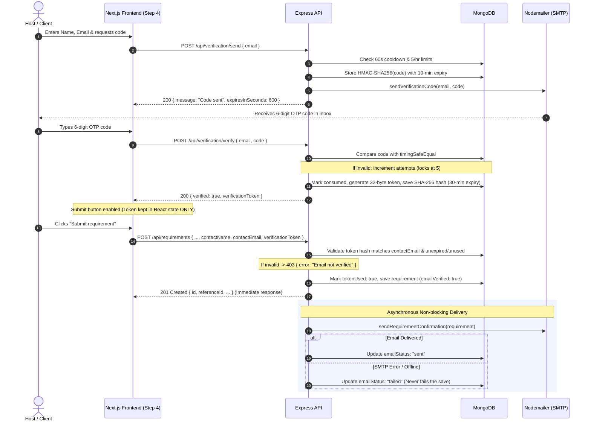

# GoPratle Backend API

Node.js, Express, and MongoDB backend service for the GoPratle event talent & services marketplace. Provides structured requirement posting, category-specific lead validation, email OTP verification, automated confirmation emails, flexible searching, and pagination.

---

## 1. Architecture & Design

- **Runtime**: Node.js with TypeScript (`tsx` for dev, `tsc` for production).
- **Web Framework**: Express 4 with security middleware (`helmet`, `cors`, `express-rate-limit`).
- **Database**: MongoDB with Mongoose ODM.
- **Email & OTP**: Nodemailer for sending transactional emails (6-digit OTP codes and requirement confirmation summaries) without tracking pixels. HTML values are escaped, and credentials/full email addresses are never logged.
- **Categorisation**: Requirements are strictly categorised into three professional roles:
  - `planner` (Event Planner)
  - `performer` (DJs, Live Bands, Solo Artists, etc.)
  - `crew` (Stage tech, Ushers, Security, Hospitality, etc.)
  Category-specific fields are stored in a dedicated `details` subdocument in MongoDB and exposed to clients both directly and via `details` for seamless Next.js frontend compatibility.
- **Identifiers**: Every requirement receives a unique formatted reference ID: `GPR-<YYYY>-<5-DIGITS>` (e.g., `GPR-2026-10492`).

---

## 2. Environment Variables

Create a `.env` file in the `server` directory (see `.env.example`):

```env
# Server Port
PORT=5000

# MongoDB Connection String (Local MongoDB or MongoDB Atlas)
MONGODB_URI=mongodb://127.0.0.1:27017/gopratle

# Allowed Client Origins for CORS (comma-separated list allowed)
CLIENT_ORIGIN=http://localhost:3000,http://127.0.0.1:3000

# Environment Mode (development | production | test)
NODE_ENV=development

# SMTP Configuration (Nodemailer)
SMTP_HOST=smtp.gmail.com
SMTP_PORT=587
SMTP_USER=your-smtp-username
SMTP_PASS=your-smtp-password
MAIL_FROM="GoPratle" <no-reply@gopratle.com>

# OTP Secret Key (Used for HMAC-SHA256 hashing)
OTP_SECRET=your-secure-otp-secret-key-min-32-chars
```

> [!IMPORTANT]
> **Production Startup Requirement**: In `production` (`NODE_ENV=production`), the server verifies all required environment variables (`SMTP_HOST`, `SMTP_PORT`, `SMTP_USER`, `SMTP_PASS`, `MAIL_FROM`, `OTP_SECRET`, `MONGODB_URI`) at boot and immediately fails with a clear fatal error message if any variable is missing.

> [!NOTE]
> **Testing Email Verification**: **Use a real inbox to test email verification.** In development, ensure you configure valid SMTP credentials or an inbox testing service (e.g., Ethereal, Mailtrap, or Gmail App Password) to receive OTP codes.

---

## 3. Email Verification & Confirmation Flow



### Rate Limits & Security

| Route | Limit | Window | Action on Exceed |
|---|---|---|---|
| `POST /api/verification/send` | 1 request | 60 seconds (per email) | `429 Too Many Requests` (`retryAfter` header & payload) |
| `POST /api/verification/send` | 5 codes | 1 hour (per email) | `429 Too Many Requests` |
| `POST /api/verification/send` | 10 requests | 1 hour (per IP) | `429 Too Many Requests` (via `express-rate-limit`) |
| `POST /api/verification/verify` | 5 failed attempts | 10 minutes | Locks code permanently; requires requesting a new code |
| `POST /api/verification/verify` | 30 requests | 1 hour (per IP) | `429 Too Many Requests` |
| `POST /api/requirements` | 5 saves | 1 hour (per email) | `429 Too Many Requests` |
| `POST /api/requirements` | 5 saves | 1 hour (per IP) | `429 Too Many Requests` (successful saves only) |

### Non-blocking Email Behaviour
- Confirmation emails are sent asynchronously **outside** the HTTP request path.
- The `POST /api/requirements` endpoint responds `201 Created` immediately with the saved document.
- If SMTP credentials fail or the mail server is unreachable, `emailStatus` in MongoDB is transitioned to `"failed"`. **A failed email never fails or rolls back the saved requirement.**
- The frontend success view detects if `emailStatus === 'failed'` and informs the user: *"We saved your requirement, but couldn't send the email."*

### Data Privacy & Serialization
- All public `GET /api/requirements` and `GET /api/requirements/:id` endpoints pass documents through a shared serializer (`serializePublicRequirement`) that strips `contactName`, `contactEmail`, `contactPhone`, `emailVerified`, `emailStatus`, and all verification hashes.

---

## 4. Known Limitations

1. **No SMS or Phone Verification**: The contact phone number is optional, unverified, and strictly validated as an Indian mobile number (10 digits starting 6–9 with optional `+91`, normalised to `+91XXXXXXXXXX`).
2. **SMTP Deliverability**: Transactional emails are dispatched via standard SMTP transport. Depending on your email provider, SPF/DKIM records, and receiver spam filters, emails may occasionally land in the recipient's spam/junk folder.

---

## 5. Scripts

From the `/server` folder:

| Command | Description |
|---|---|
| `npm run dev` | Start development server with hot reload via `tsx watch` |
| `npm run build` | Compile TypeScript to JavaScript in `dist/` |
| `npm run start` | Run compiled server in production mode |
| `npm test` | Run Supertest suite with all verification & requirements tests |
| `npm run seed` | Manually seed realistic demo requirements marked with `source: "demo"` |

---

## 6. Database Schema & Indexes

### EmailVerification Collection (`EmailVerification`)
- `email`: Lowercased email address (indexed)
- `codeHash`: HMAC-SHA256 hash of the 6-digit code using `OTP_SECRET`
- `expiresAt`: Date (10 minutes from creation)
- `attempts`: Number of failed attempts (locks at 5)
- `consumed`: Boolean flag indicating if the code has been consumed
- `verifiedAt`: Timestamp when code was successfully verified
- `tokenHash`: SHA-256 hash of the issued 32-byte verification token
- `tokenExpiresAt`: Date (30 minutes from verification)
- `tokenUsed`: Boolean flag preventing token reuse
- `createdAt`: Document creation timestamp
- **TTL Index**: `{ expiresAt: 1 }` with `expireAfterSeconds: 86400` (auto-purged 24 hours after expiry)

### Requirement Collection (`Requirement`)
- Added fields:
  - `contactName`: String (required, max 150 chars)
  - `contactEmail`: String (required, lowercased, valid email)
  - `contactPhone`: String (optional, normalized `+91XXXXXXXXXX`)
  - `emailVerified`: Boolean (true upon verified submission)
  - `emailStatus`: Enum (`'pending'`, `'sent'`, `'failed'`)
- Existing category-specific structures and indexes remain intact.
